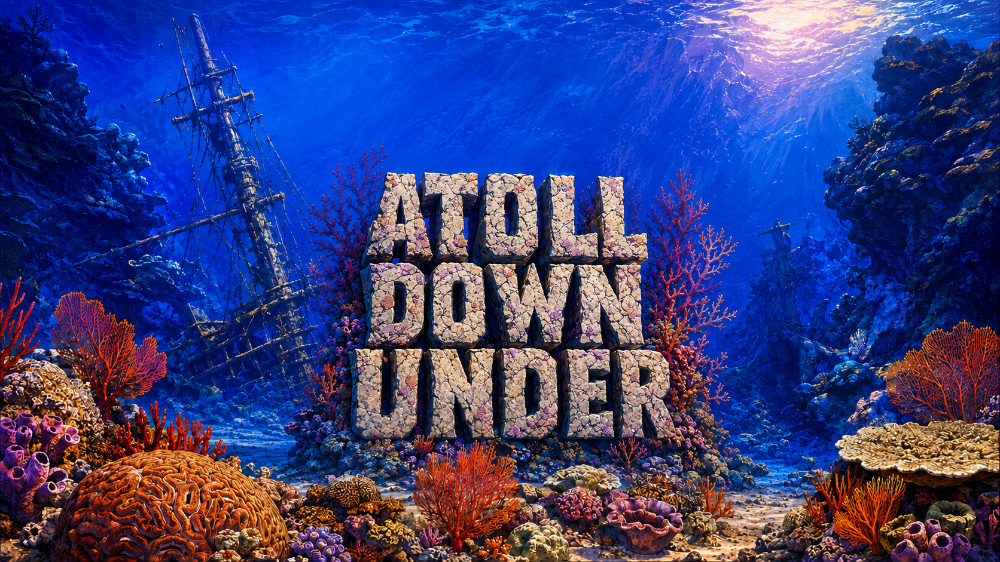

# Atoll Down Under

[](https://github.com/ddevillier/atoll-down-under/actions/workflows/windows.yml)

An offline, widescreen reef exploration game inspired by Odell Down Under, with
new artwork, music and gameplay. Swim as different species, discover their ways
of living, care for other fish, and create your own creature.



- Nine connected illustrated habitats and 57 playable species, plus seven resident creatures.
- Optional species journeys, cleaning, camouflage, tactile sand searches, grazing and mouthbrooding care.
- Practice, Challenge, Tournament and a modular creature creator.
- Articulated swimming, schooling, feeding, predators and cleaner visits.
- Local saved dives, a persistent family journal, discoveries and color rewards.
- Original music, sound effects and complete offline spoken guidance.

This is a developing game with stylized biology and compressed ecological time.
It is a new interpretation, with independently authored assets and balancing.
Windows x64 is the supported desktop build target.

## Run from source

Install [Node.js](https://nodejs.org/) **22.18.0** (the version in .nvmrc) and Git.
Then run these commands in PowerShell or a terminal:

```sh
git clone https://github.com/ddevillier/atoll-down-under.git
cd atoll-down-under
npm ci
npm run check
npm start
```

**Every required asset is included in the checkout. No API key, paid service,
Python, FFmpeg, original game installation or asset generation is needed to run
or build the game.** npm ci downloads the pinned development dependencies and
Electron. Once installed, the game runs offline.

For a browser preview, use `npm run dev` and open http://127.0.0.1:4173.
Use the server rather than opening index.html directly.

## Build Windows

```sh
npm run build:win
```

This creates a new dated folder under dist/, verifies packaged source/assets,
and prints the exact executable path. Copy the **whole** Atoll Down Under-win32-x64
folder to run it elsewhere; the EXE depends on its neighboring files.
To choose a fresh output directory explicitly:

```sh
npm run build:win -- --out dist/my-windows-build
```

The build refuses to replace an existing output directory. No signing certificate
is configured, so the current Windows executable is unsigned.

GitHub's [Windows workflow](https://github.com/ddevillier/atoll-down-under/actions/workflows/windows.yml)
checks clean checkouts, runs the full browser suite in four Windows shards plus
unit/native tests, builds the game only after every check succeeds, and
uploads a verified portable ZIP with its receipts. Open a successful run and
expand **Artifacts** to download **Atoll-Down-Under-Windows**. Artifact downloads
require signing in to GitHub. Forks can run the same workflow for testing without
secrets; sharing asset-containing fork builds remains subject to the
[asset permission](assets/LICENSE.md).

See [build and test details](docs/BUILDING.md) for ZIP creation, troubleshooting
and optional asset-authoring tools.

## Controls

| Input | Action |
|---|---|
| Mouse movement | Swim toward the pointer |
| Click a creature or food | Approach; feed or help a compatible client |
| E | Context activity: probe sand, invite a companion, choose a home and more |
| Space | Species special ability |
| Escape / P | Pause and inspect / resume |
| H | Suitable food hints |
| F / M | Field guide / reef map |
| Ctrl+S | Save the dive |
| F11 | Switch between fullscreen and windowed mode |

Activities remain optional. Practice offers gentle, recoverable danger. Sound
starts after interaction; music, effects and narration have separate controls.

## Develop and verify

```sh
npm test
npx playwright install chromium
npm run test:e2e
npm run test:desktop
```

Browser tests start their own local server. Native tests use temporary profiles
so they do not replace player saves. [Contributing](CONTRIBUTING.md) describes
where gameplay, rendering and test code live.

## License and assets

The original **code is MIT licensed**; **game assets have reserved rights** with
permission to clone/fork, build, modify and play this project for personal use,
testing and contributions. The complete assets remain in the repository.
They are not generally licensed for extraction or reuse in other games.
See [the code license](LICENSE), [asset permission](assets/LICENSE.md), and
[third-party provenance](docs/PROVENANCE.md). Fonts retain their own licenses.

Original-game executables, decompiled materials, local credentials, test captures
and packaged historical builds are not part of this repository.

